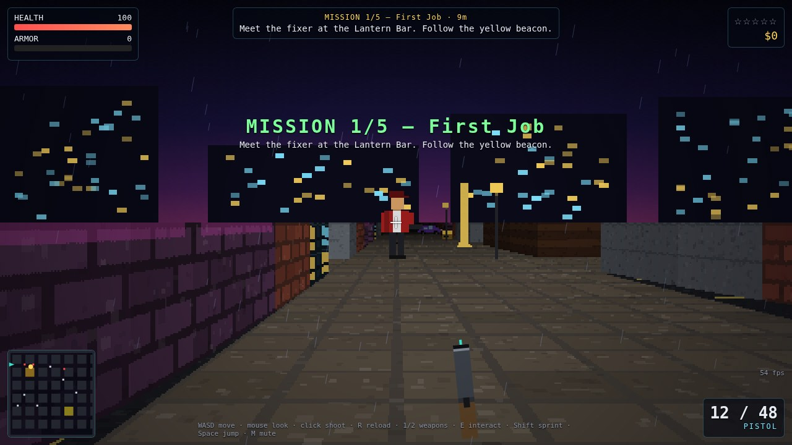

# NEONHARBOR 3D — a first-person open-world crime game

[](https://make.fun/bounty/gta6-01?utm_source=github&utm_medium=readme&utm_campaign=gta6-01)
[](https://make.fun/bounty/gta6-01/leaderboard?utm_source=github&utm_medium=readme&utm_campaign=gta6-01)
[](https://make.fun/bounty/gta6-01?utm_source=github&utm_medium=readme&utm_campaign=gta6-01)

Entered on [make.fun](https://make.fun/?utm_source=github&utm_medium=readme&utm_campaign=gta6-01) — see the [gta6-01 bounty](https://make.fun/bounty/gta6-01).



**NEONHARBOR 3D** is an original first-person open-world crime game, built for
the make.fun bounty **gta6-01** ("Make GTA 6", $1,666). You are **Rook**, a
driver-for-hire in Neon Harbor, a rain-soaked neon coastal city. Take jobs from
the fixer at the Lantern Bar, clear the alley of rivals, steal a sedan for the
Chop Shop, survive the plaza ambush, and outrun the Harbor PD to the waterfront
— all in first person, with a wanted system, rival gangs, police, and a
living neon city.

Everything is original: our own city, characters, missions, names, story, art
and sound. The 3D engine is ours too — a raycaster written from scratch on raw
canvas 2D (no library, no downloaded engine code). All art and sound are
generated in code; the game loads no assets and makes no network requests.

## How to play

Serve the game with any static file server and open `game/index.html` in
desktop Chrome:

```sh
node serve.ts        # serves game/ at http://localhost:8080
```

Or open `game/index.html` directly from disk (ES modules load from file://).

**Controls:** WASD move · mouse look (click to lock the pointer) · click shoot ·
R reload · 1/2 switch pistol/shotgun · E interact / steal & exit car ·
Shift sprint · Space jump · Esc pause · M mute.

## The game

- **First-person 3D city** — our own raycast engine: textured brick, concrete,
  neon and glass towers, asphalt roads, brick sidewalks, harbor plaza, night
  skyline, rain and a neon glow. 60 fps.
- **On foot and driving** — walk the streets, or steal a parked sedan and drive
  it (WASD + steering) to the Chop Shop.
- **Combat** — hitscan pistol and shotgun (pickups), reload, muzzle flash,
  hit feedback. Rival gang members and Harbor PD with chase-and-shoot AI.
- **Wanted system** — 1–5 stars. Killing police raises the heat; police spawn
  pressure rises with the stars; lay low and it cools off.
- **5 story missions** — First Job, Alley Heat, Hot Wheels, Ambush (3 waves),
  Harbor Getaway (90-second timed escape) — plus free roam after the finale.
- **HUD** — health/armor bars, ammo, cash, wanted stars, objective + distance,
  live minimap, mission banners.
- **Sound** — fully synthesized WebAudio: gunshots, pickups, mission stingers,
  police sirens and rain ambience.
- **Save** — progress (missions, cash, kills) saves to localStorage; continue
  from the title screen.

## Tests

```sh
node tests/logic.mjs        # headless logic tests (no browser)
node tests/bundle.mjs       # build tests/bundle.html (single-file copy)
bash tests/chrome.sh 9227   # launch the test browser (then CDP_PORT=9227 ...)
CDP_PORT=9227 node tests/playtest-cdp.mjs   # scripted CDP playtest
CDP_PORT=9227 node tests/shots-cdp.mjs     # take the 4 screenshots
```

## Files

- `game/index.html` — the game page (DOM HUD + canvas)
- `game/src/` — the engine and game logic (ES modules, no dependencies)
  - `config.js` tuning & mission definitions · `random.js` seeded RNG
  - `map.js` city generation, collision, line-of-sight · `raycast.js` DDA math
  - `combat.js` hitscan, damage, wanted · `player.js` movement & driving
  - `enemies.js` gang/police AI & spawning · `missions.js` story state machine
  - `world.js` game state & update · `save.js` localStorage
  - `textures.js` procedural textures & sprites · `render.js` raycast renderer
  - `audio.js` WebAudio synth · `input.js` keyboard/mouse/pointer lock
  - `ui.js` HUD & minimap · `main.js` loop, screens, `window.__nh3d` API
- `main.ts` — the program entrypoint (copies `game/` + `screenshots/` to
  `/output` and writes `dossier.json`)
- `tests/` — logic tests, bundle builder, CDP playtest & screenshot drivers
